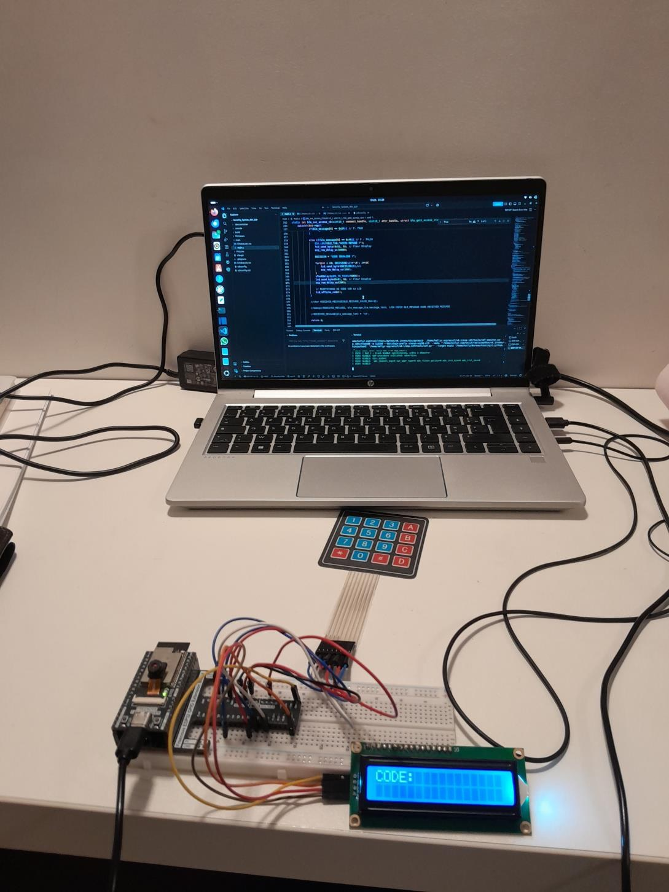
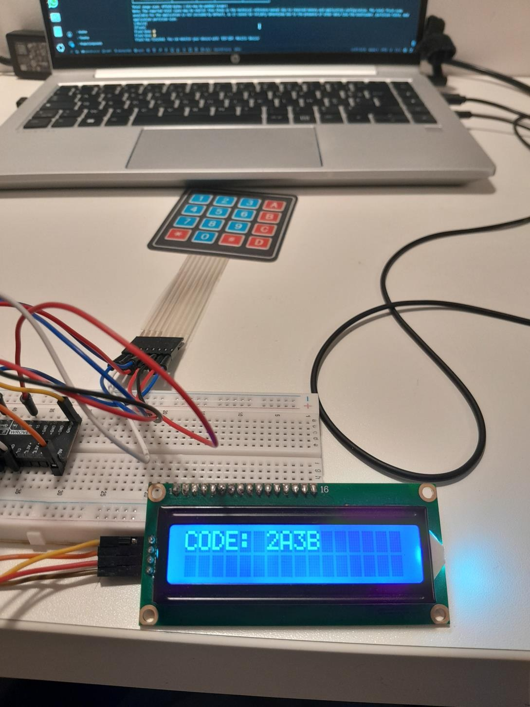
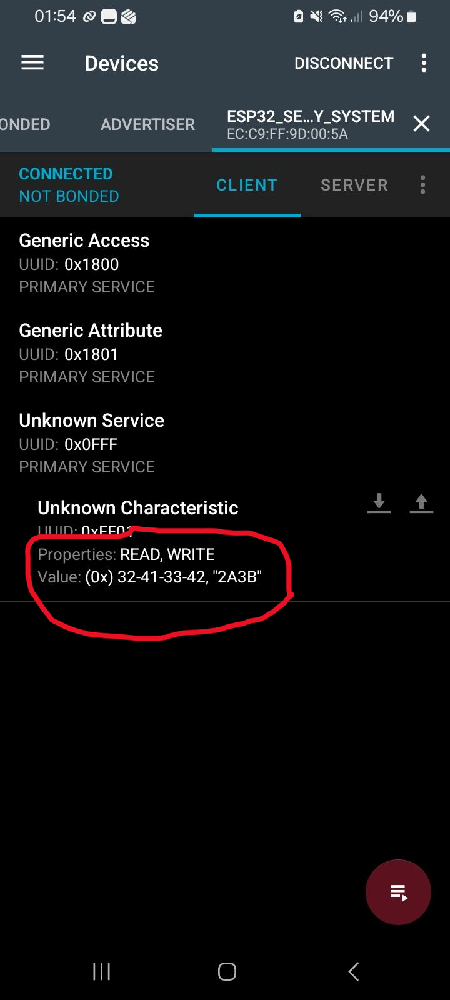
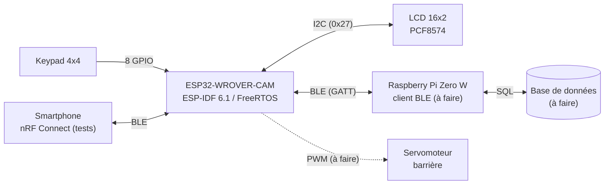
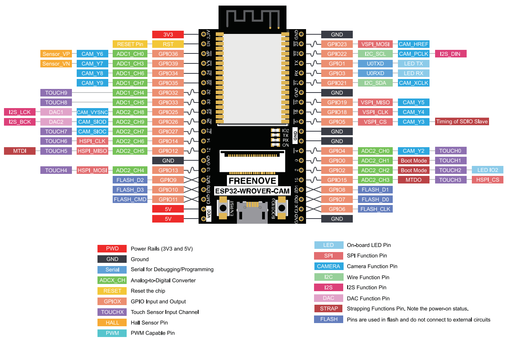

# Projets personnels

Bienvenue sur mon dépôt de projets personnels, consacrés principalement à l'**électronique embarquée** et aux **systèmes connectés**. Chaque projet a son propre dossier, avec son code, sa documentation et ses résultats.

> **Auteur :** Kelly Kassin ([@kassingit](https://github.com/kassingit))
> **Dernière mise à jour :** octobre 2026

---

## Sommaire

- [Liste des projets](#liste-des-projets)
- [Projet 3 : système de sécurité ESP32 + Raspberry Pi](#projet-3)
- [Organisation du dépôt](#organisation-du-depot)
- [Contact](#contact)

---

## Liste des projets

| N° | Projet | Technologies | Statut |
|----|--------|--------------|--------|
| 1 | *À compléter* | *À compléter* | *À compléter* |
| 2 | *À compléter* | *À compléter* | *À compléter* |
| 3 | [Système de sécurité par code d'accès (ESP32 ↔ Raspberry Pi en BLE)](#projet-3) | ESP-IDF 6.1, C, FreeRTOS, I2C, BLE (NimBLE), Raspberry Pi | 🚧 En cours (≈ 52 %) |

---

<a id="projet-3"></a>

## Projet 3 : système de sécurité ESP32 + Raspberry Pi


Contrôle d'accès par code pour la barrière d'un immeuble. L'habitant saisit un code sur un **keypad 4×4** ; les caractères s'affichent en temps réel sur un **LCD 16×2** ; le code est transmis en **Bluetooth Low Energy** à un **Raspberry Pi** qui le vérifie dans une base de données et renvoie une décision (accès accordé ou refusé). À terme, l'ESP32 commande un servomoteur qui lève la barrière.

<table>
  <tr>
    <td align="center"><br><sub>Poste de travail</sub></td>
    <td align="center"><br><sub>Code « 2A3B » saisi au keypad et affiché sur le LCD</sub></td>
    <td align="center"><br><sub>Code lu par le téléphone (nRF Connect)</sub></td>
  </tr>
</table>

### Objectifs

- Écrire un pilote **I2C au niveau registre** (sans bibliothèque d'écran toute faite) avec l'API `i2c_master` d'ESP-IDF.
- Organiser le firmware en **tâches FreeRTOS**.
- Mettre en place un **serveur GATT BLE** avec NimBLE et le valider avec un smartphone.
- Intégrer un **Raspberry Pi** comme serveur de vérification (base de données, historique des accès).

### Architecture



### Matériel

| Composant | Rôle | Interface |
|-----------|------|-----------|
| ESP32-WROVER-CAM (Freenove) | Microcontrôleur principal | - |
| LCD 1602A + backpack PCF8574 | Affichage 16×2, adresse `0x27` | I2C |
| Keypad matriciel 4×4 | Saisie du code | 8 GPIO |
| Raspberry Pi Zero W | Vérification des codes, base de données | BLE |
| Servomoteur | Levée de la barrière | PWM |

### Câblage

| Signal | GPIO | Remarque |
|--------|------|----------|
| SDA (I2C) | 21 | Partagé avec `CAM_XCLK` |
| SCL (I2C) | 22 | Partagé avec `CAM_PCLK` |
| Lignes du keypad | 12, 13, 14, 32 | Sorties |
| Colonnes du keypad | 0, 5, 18, 19 | Entrées avec pull-up |

> ⚠️ La carte WROVER-CAM partage de nombreux GPIO avec le capteur caméra. La caméra n'étant **jamais initialisée** dans ce projet, aucune horloge `XCLK` n'est générée. La colonne 1 est sur le GPIO 0, une broche de *strapping* (mode de démarrage) : ne pas maintenir de touche enfoncée au démarrage. L'affectation est à valider définitivement.



### Fonctionnement

1. `keypad_task` balaie le keypad toutes les 10 ms (anti-rebond de 20 ms) et affiche chaque touche sur le LCD.
2. Après **4 caractères**, le code est publié dans la caractéristique BLE.
3. Un client BLE lit le code et écrit en retour **1 octet** de décision.

| Sens | Contenu | Format |
|------|---------|--------|
| ESP32 → client (lecture) | Code saisi | 4 caractères ASCII (ex. `2A3B`) |
| Client → ESP32 (écriture) | Décision | `'T'` (`0x54`) accès accordé, `'F'` (`0x46`) refusé |

**Interface GATT :** nom annoncé `ESP32_SECURITY_SYSTEM`, service `0x0FFF`, caractéristique `0xFF01` (READ + WRITE, 64 octets maximum).

### Compilation et test

Prérequis : ESP-IDF 6.1 installé (ESP-IDF Installation Manager) et un chemin de projet **sans espace**.

```bash
source ~/.espressif/tools/activate_idf_v6.1.sh
cd PROJET_3/Security_System_RPI_ESP
idf.py set-target esp32
idf.py menuconfig        # Component config > Bluetooth > activer, Host : NimBLE
idf.py build
idf.py -p /dev/ttyUSB0 flash monitor
```

Pour tester le serveur BLE : ouvrir **nRF Connect** sur un smartphone, se connecter à `ESP32_SECURITY_SYSTEM`, puis lire ou écrire la caractéristique `0xFF01` dans le service `0x0FFF`.

### Avancement

| Tâche | Statut |
|-------|--------|
| Protocole I2C | ✅ Terminé |
| Pilote LCD (PCF8574, mode 4 bits) | ✅ Terminé |
| Pile BLE (NimBLE, serveur GATT) | ✅ Terminé |
| Gestion des tâches keypad / BLE | ✅ Terminé |
| Communication ESP32 ↔ téléphone | ✅ Terminé |
| Mutex pour l'accès au LCD / bus I2C | 🚧 En cours |
| Connexion du Raspberry Pi au BLE | ⬜ À faire |
| Base de données des habitants (sur le Raspberry Pi) | ⬜ À faire |
| Communication Raspberry Pi ↔ ESP32 | ⬜ À faire |
| Vérification des codes et envoi de commandes | ⬜ À faire |

Prochaines étapes : commande du servomoteur, sécurisation du lien BLE, maquette 3D de l'immeuble et vidéo de démonstration.

### Limites connues

- **Prototype, pas un produit fini.** Le lien BLE n'est pas appairé ni chiffré : tout appareil à portée peut se connecter et écrire une décision. L'appairage et le chiffrement sont prévus avant tout usage réel.
- Des caractères parasites peuvent apparaître sur le LCD quand le callback BLE et le keypad écrivent en même temps : c'est l'objet du mutex en cours.
- Le tampon BLE doit encore être protégé contre les écritures trop longues.

### Compétences mises en œuvre

Programmation embarquée en **C** avec ESP-IDF · protocole **I2C** au niveau protocole (adressage, ACK, pull-up, signal Enable) · pilotage d'un **HD44780** via **PCF8574** en mode 4 bits · **FreeRTOS** (tâches, ordonnancement, concurrence) · **Bluetooth Low Energy** (GATT, services, caractéristiques, advertising) · lecture de brochage et gestion des GPIO partagés · débogage par journaux · **Git / GitHub**.

### Documentation

Un rapport détaillé (28 pages : schémas, tests, difficultés rencontrées, analyse de sécurité, feuille de route) est disponible : [`PROJET_3/docs/rapport_avancement.pdf`](PROJET_3/docs/rapport_avancement.pdf).

---

<a id="organisation-du-depot"></a>

## Organisation du dépôt

```text
.
├── README.md
├── PROJET_1/                      # à compléter
├── PROJET_2/                      # à compléter
└── PROJET_3/
    ├── Security_System_RPI_ESP/   # firmware ESP32 (ESP-IDF 6.1)
    │   ├── main/main.c
    │   └── CMakeLists.txt
    └── docs/
        ├── rapport_avancement.pdf
        └── images/
```

---

<a id="contact"></a>

## Contact

- GitHub : [@kassingit](https://github.com/kassingit)
- Courriel : *à compléter*
- LinkedIn : *à compléter*

---

## Licence

*À définir (par exemple MIT).*
